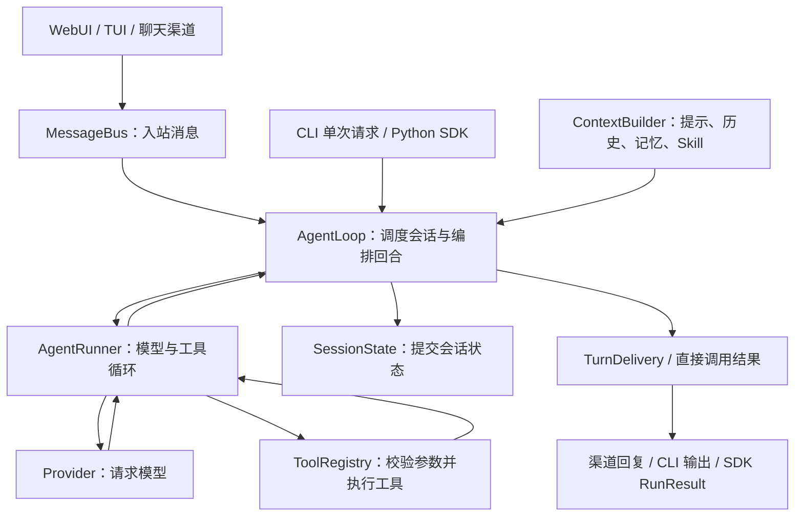

# 01：框架地图与源码索引

学习目标：能沿一条请求定位 nanobot 的代码，判断金融能力该放在哪里，并分清对话、上下文和长期资料的归属。版本基准见 [README](./README.md)。

## 一条请求如何执行

nanobot 为模型提供上下文、工具和执行控制。一个用户回合（turn）可以包含多次模型请求及工具调用，并在执行过程中保存状态与发布事件。

这是普通路径的概念图。Gateway 渠道输入通过入站队列；CLI `agent -m` 和 SDK 经 `AgentLoop.process_direct()` 直接进入运行时。斜杠命令可以在请求模型前处理；用户输入及执行 checkpoint 会提前持久化，最终答复另行提交。

| 核心模块 | 它解决的问题 | 首读符号 |
| --- | --- | --- |
| [AgentLoop](../nanobot/agent/loop.py) | 输入属于哪个会话、使用哪个模型/项目、如何保存和回复？ | `run()`、`_process_message()`、`process_direct()` |
| [ContextBuilder](../nanobot/agent/context.py) | 当前请求具体带给模型哪些材料？ | `build_system_prompt()`、`build_transcript()` |
| [AgentRunner](../nanobot/agent/runner.py) | 如何请求模型、执行工具、回传结果及结束迭代？ | `run()`、`_run_core()`、`_invoke_model()` |
| [ToolRegistry](../nanobot/agent/tools/registry.py) | 哪些工具可用、参数是否合规、调用如何执行？ | `get_definitions()`、`prepare_call()`、`execute()` |
| [TurnDelivery](../nanobot/agent/turn_delivery.py) | 如何组织最终回复与完成事件？ | `complete()` |

Python Gateway 拥有执行、会话、工具、记忆和安全策略，WebUI/TUI 共享这个运行时；SDK 将同一执行能力嵌入调用方 Python 进程。界面展示与业务执行分工不同，金融业务逻辑应留在运行时扩展或外部服务中。

## 模型到底看见什么

`ContextBuilder` 组合内置身份/平台模板、项目 `AGENTS.md`、Agent 的 `SOUL.md` / `USER.md`、长期记忆、Skill 信息及会话摘要，再与历史消息和当前输入组成请求。工具定义由工具注册表提供，Provider 将这些材料转换为目标模型 API 的格式。

Skill 采用渐进加载：常驻 Skill 可进入系统提示，其余通常提供摘要，由模型按需读取，显式 `$skill-name` 也可注入相关指令。财报原文、检索命中和工具结果会占用上下文预算；框架的上下文压缩不能代替业务数据筛选。

## Session、Memory 与工作区

| 概念 | 保存或影响什么 | 默认位置/拥有者 |
| --- | --- | --- |
| 配置 | Provider、模型预设、工具、渠道和运行设置 | `~/.nanobot/config.json` |
| Session | 模型消息历史、元数据、摘要边界和恢复状态；另存显示事实 | `<config-dir>/sessions/<workspace-id>/sessions.sqlite3` |
| Agent 工作区 | 身份、用户资料、长期记忆、自定义 Skill 等 | `~/.nanobot/workspace/` |
| 项目工作区 | 当前项目指令、相对文件路径和 shell 工作目录 | 会话选择的项目；可与 Agent 工作区相同 |
| Memory | 提供给模型的长期资料及归档整理来源 | `<agent-workspace>/memory/MEMORY.md`、`history.jsonl` |
| MessageBus | 进程内入站/出站异步队列与本地事件发布 | 内存；不提供持久消息中间件能力 |

运行时会话修改由 `SessionState` 管理，经 `SqliteSessionStore` 提交 SQLite 事务；`SessionManager.save()` 用于离线管理快照。摘要改变后续回放的上下文边界，完整持久化历史仍可由会话工具检索。UI 的流式 delta 与显示事实不自动进入模型历史。

Memory 当前以 Markdown 为长期上下文，`history.jsonl` 是归档/Dream 来源，并非逐条聊天原文。Dream 根据累计资料整理长期记忆及相关工作区文件；它不是每次答复后必然执行的动作。SDK 本身不启动 Gateway 的周期 Dream 调度。

同一实例中的会话共享 Agent 工作区的长期记忆、文件、工具和凭据。改变 `session_key` 或选择另一个项目只改变相应对话/项目上下文；需要独立资料边界时使用独立实例，并按需求配置进程与文件权限。

Subagent 是主会话拥有的委派任务，拥有自己的任务历史和状态，通过 `subagent` 工具创建、查看、发消息或取消。它不自动复制主会话的全部上下文，主任务要在任务描述中传递必要材料；后台完成结果回到发起会话，单次 CLI/SDK 在不能后台投递时等待结果。

## 金融能力放在哪个扩展点

| 扩展点 | 适合放什么 | 当前接入方式 |
| --- | --- | --- |
| Tool | 指标计算、结构化数据查询、确定性校验 | 实现 [Tool](../nanobot/agent/tools/base.py)；[ToolLoader](../nanobot/agent/tools/loader.py) 发现内置类或 `nanobot.tools` Python entry points |
| Skill | 分析步骤、指标口径说明、如何使用工具和引用证据 | Agent 工作区 `skills/<name>/SKILL.md`；也可打包到 Agent Plugin |
| MCP | 远程公告检索、行情服务、机构内部知识检索 | 配置 `tools.mcpServers`；由 [MCPProvider](../nanobot/agent/tools/mcp.py) 将服务工具接入注册表 |
| Provider | 企业模型接口、本地推理服务或特定协议 | 优先使用现有 Provider 配置；确有适配需求再扩展 registry/schema/adapter |
| Channel | 飞书等交互入口、机构内部聊天入口 | 自包含 `nanobot/channels/<channel>/` 包；见[渠道扩展规范](../docs/channel-package-guide.md) |

Tool 负责能力，Skill 负责使用方法，MCP 负责把外部能力暴露为工具。Agent Plugin 是可组合 Skill 和 MCP 的安装包，与 Python 的 `nanobot.tools` entry point 插件机制不同。

自定义工具放在 `tutorials_lgx/examples/` 不会自动被扫描，需要明确注册或安装 entry point 包。[docs/my-tool.md](../docs/my-tool.md) 是内置 `my` 自我检查工具文档；SDK 接入以 [Nanobot.from_config()](../nanobot/nanobot.py) 的真实参数为准。MCP 连接与关闭由应用入口管理，核心 Loop 接收调用方提供的注册表。

以下是金融原型的设计建议：业务知识和行情事实存入外部检索/数据库，Tool 或 MCP 返回来源、数据时点、币种、单位与指标口径；用确定性代码计算财务指标，让模型承担任务理解、资料选择和解释。先在固定公开/合成样本上评估来源可追溯、数字准确、时间口径一致和工具失败反馈。授权与业务限制在工具服务端落实，Prompt/Skill 只提供行为指导。

## 按问题找源码与测试

| 要研究的问题 | 文档与源码入口 | 现有测试入口 |
| --- | --- | --- |
| 如何启动/组装 Gateway？ | [Architecture](../docs/architecture.md)、[gateway_runtime.py](../nanobot/cli/gateway_runtime.py) | [tests/gateway](../tests/gateway/)、[tests/cli](../tests/cli/) |
| 如何用 Python 调用 Agent？ | [Python SDK](../docs/python-sdk.md)、[Nanobot](../nanobot/nanobot.py)、[SDK helpers](../nanobot/sdk/) | [test_sdk_streaming.py](../tests/test_sdk_streaming.py) |
| 回合与工具迭代如何衔接？ | [loop.py](../nanobot/agent/loop.py)、[runner.py](../nanobot/agent/runner.py) | [test_loop_runner_integration.py](../tests/agent/test_loop_runner_integration.py)、[test_runner_core.py](../tests/agent/test_runner_core.py) |
| Prompt 与 Skill 如何装配？ | [context.py](../nanobot/agent/context.py)、[skills.py](../nanobot/agent/skills.py)、[templates](../nanobot/templates/) | [test_context_builder.py](../tests/agent/test_context_builder.py)、[test_skills_loader.py](../tests/agent/test_skills_loader.py) |
| 如何增加/执行工具？ | [base.py](../nanobot/agent/tools/base.py)、[loader.py](../nanobot/agent/tools/loader.py)、[registry.py](../nanobot/agent/tools/registry.py) | [test_tool_registry.py](../tests/tools/test_tool_registry.py)、[test_tool_loader_entrypoints.py](../tests/agent/test_tool_loader_entrypoints.py) |
| 如何接外部 MCP？ | [MCP 配置](../docs/guides/configure-mcp-tools.md)、[mcp.py](../nanobot/agent/tools/mcp.py) | [test_mcp_connection.py](../tests/agent/test_mcp_connection.py) |
| 会话如何持久化？ | [state.py](../nanobot/session/state.py)、[sqlite_store.py](../nanobot/session/sqlite_store.py)、[manager.py](../nanobot/session/manager.py) | [tests/session](../tests/session/)、[test_loop_recovery.py](../tests/agent/test_loop_recovery.py) |
| 长期记忆如何形成？ | [Memory](../docs/memory.md)、[memory.py](../nanobot/agent/memory.py) | [test_memory_store.py](../tests/agent/test_memory_store.py)、[test_dream.py](../tests/agent/test_dream.py) |
| 模型与参数如何选择？ | [Provider 扩展](../docs/development.md)、[factory.py](../nanobot/providers/factory.py)、[routing.py](../nanobot/providers/routing.py) | [tests/providers](../tests/providers/)、[test_model_presets.py](../tests/config/test_model_presets.py) |
| 委派任务如何运行？ | [subagent.py](../nanobot/agent/subagent.py)、[subagent 工具](../nanobot/agent/tools/subagent.py) | [test_subagent_lifecycle.py](../tests/agent/test_subagent_lifecycle.py)、[test_subagent_tools.py](../tests/agent/tools/test_subagent_tools.py) |
| 工具访问权限在哪执行？ | [安全边界](../.agent/security.md)、[execution](../nanobot/execution/)、[security](../nanobot/security/) | [tests/security](../tests/security/)、[test_workspace_scope.py](../tests/agent/test_workspace_scope.py) |

先读表中拥有该问题的模块，再沿调用者扩展；测试是行为样例和后续修改的验证入口。本轮没有执行这些测试。
